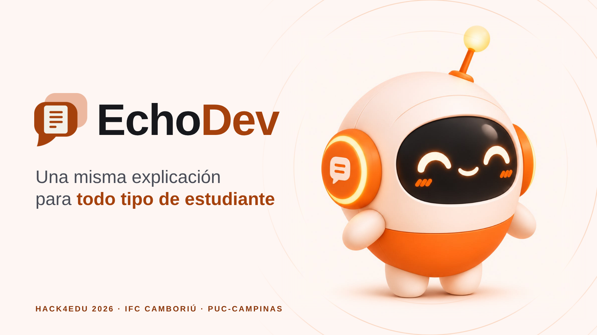

# 🚀 EchoDev#

# EchoDev: Una misma explicación para todo tipo de estudiante

## Overview

---
# EchoDev
Reto 26: Cada uno con su ritmo

¿Cómo podemos ayudar para que los estudiantes con ritmos de aprendizaje distintos sigan las sesiones de aula?

Diseñe una solución que ayude a todos los estudiantes a seguir la explicación del profesor en tiempo real —cada uno a su propio ritmo— sin añadir carga de trabajo al docente. La propuesta debe mantener al profesor como eje de las decisiones, permitirle revisar cualquier contenido antes de que llegue a los estudiantes y garantizar la privacidad de los datos

# Problema
  El estudiante se pierde y nadie lo sabe, tres cosas a la vez:
  
    + 1) Lo que dice el profesor
    
    + 2) Lo que escribe en pantalla
    
    + 3) Vocabulario técnico en inglés como ejemplo (Diversos idiomas)
    

# Solución Projecto EchoDev#2026
   Una misma explicación para cada ritmo
   
    - PARA EL ESTUDIANTE
    
     + Transcripción en vivo - Todo lo que dice el profesor, en texto.
     + Texto a tu medida - Tamaño de letra e idioma ajustables.
     + Resumen y quiz - Para repasar, con el aval del profesor.

          Nota: Prototipo de las pantallas del estudiante (interfaz en portugués)
